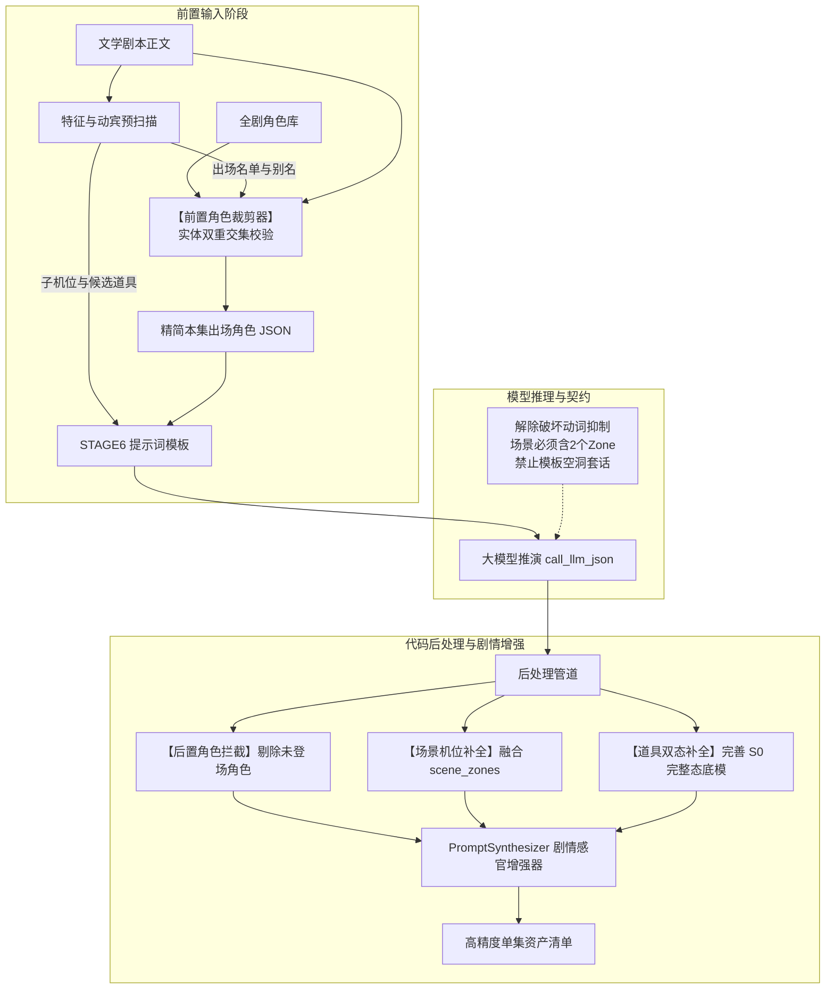

## 需求概述
针对阶段 6（`stage6_asset_truth`）在经由大模型推演抽取资产清单时暴露的四大痛点——未出场角色被误抽取、场景颗粒度粗略缺乏子机位与剧情痕迹、道具抽取受限且漏抽关键交互物证、以及生图提示词模板化脱离剧情氛围，进行全流程系统性重构与质效升级。

## 核心功能
- **角色前置白名单裁剪与后置硬拦截**：调用大模型前根据剧本预扫描结果过滤注入的角色库，断绝未出场角色对大模型注意力的干扰；后处理增加出场交集强校验，彻底杜绝幽灵角色。
- **场景三级空间机位与剧情痕迹细化**：升级提示词约束，强制主场景提取不少于两个子机位区域与剧情物理痕迹；代码层自动将扫描算子捕获的机位区域实体化为场景资产。
- **道具去抑制与三级捕获网构建**：解除破坏动词过度抑制，支持未破损核心物证标准底模与手持动作交互道具建档；动宾短语候选物证显式注入模型进行状态确认。
- **生图提示词剧情感官自动增强**：禁止空洞占位符；构建后处理提示词自动注入流水线，将当集情绪、气候光影、战损伤痕与物理摆放介质无缝编译进提示词。


## 技术选型
- **执行环境**：Python 3.10+、LangGraph 状态机驱动节点。
- **核心模块**：
  - `stage6_asset_truth.py`：单集资产真理源提取执行节点；
  - `master_sop_prompts.py`：阶段 6 系统提示词（`STAGE6_SYSTEM_PROMPT`）与输入模板（`STAGE6_USER_PROMPT_TEMPLATE`）；
  - `prompt_synthesizer.py`：工业级提示词四维解耦与感官增强合成器；
  - `screenplay_feature_scanner.py`：剧本特征与动宾短语逆向提取引擎；
  - `pytest`：全量功能与回归单测套件。

## 实现方案
### 1. 角色前置精准裁剪与后置兜底守卫（双保险防御）
- **前置裁剪（主攻手）**：在 `stage6_asset_truth_node` 中调用 `scan_screenplay_features` 获得 `characters_detected` 与 `character_alias_map`。在序列化 `characters_engine_json` 前，对全量角色库执行实体交集匹配（满足扫描器命中、别名命中或剧本台词/动作中出现），精炼为 `ep_active_chars` 注入提示词，彻底杜绝大模型因全量角色输入而产生的格式填充幻觉。
- **后置硬拦截（安全网）**：在解析大模型返回的 `manifest_data['characters']` 时，强制校验角色是否在当集登场名单内，拦截剔除未出场实体。

### 2. 场景三级空间机位架构升级
- **Prompt 契约升级**：重塑系统提示词中场景提取 SOP，明确要求主场景（`T1_PRIMARY`）必须结合当集剧情动作位置，输出至少 1~2 个子机位区域（`Z01/Z02`，如吧台暗角、生锈铁梯、落地窗边），并提取由剧情引发的环境物理痕迹（如碎玻璃、水渍、弹孔）。
- **代码层自动补录**：在后处理中提取 `scanner_result.scene_zones_detected`，将模型遗漏但动作行明确涉及的子区域动态挂载为二级场景资产。

### 3. 道具去抑制与交互物证完善
- **废除过度抑制铁律**：重构系统提示词，确立“T1 核心物证标准完整态 `S0_STATIC` 稳定输出”、“T2 动作交互道具（手枪、钥匙、录音笔等手持物品）建档”以及“仅当命中物理破坏时增生 `ACTION/S1` 资产”的三级资产策略。
- **动宾候选物证显式呈现**：将扫描算子抽取的动态道具和角色随身物证作为建议池传入模型提示词，引导模型做存在性与状态确认。

### 4. 提示词剧情物理感官自动化增强
- **提示词黑名单与质量红线**：严禁模型输出 `visual style: [visual_style]` 等模板套话，要求描述具体的摄影焦段、布光角度与材质质感。
- **后处理自动化增强管道**：扩充 `PromptSynthesizer`，在生成/纠偏资产提示词时融合当集剧本文学上下文：
  - **角色**：注入微表情（如咬牙、眼角充血）、上一集战损血迹、站立软阴影；
  - **场景**：注入现场气候（如暴雨水雾、逆光强对比）与环境磨损；
  - **道具**：注入微距景深、具体放置表面物理材质（如斑驳湿铁板）与光泽机理。

## 架构设计


## 目录结构
```
python-backend/
├── app/
│   ├── workflows/
│   │   ├── nodes/
│   │   │   └── stage6_asset_truth.py        # [MODIFY] 实现角色前置过滤、后置硬拦截、场景Zone补录及提示词增强接入
│   │   ├── prompts/
│   │   │   └── master_sop_prompts.py        # [MODIFY] 重塑阶段6系统提示词与输入模板，去除道具抑制，强化场景Zone与提示词质量
│   │   └── utils/
│   │       └── prompt_synthesizer.py        # [MODIFY] 升级提示词合成器，提供剧情感官增强（微表情、气候、战损、物理介质）
└── tests/
    └── unit/
        └── test_stage6_extraction_quality.py # [NEW] 针对四大改进点的专用端到端质量验证单测套件
```

## 关键代码结构
```python
class PromptSynthesizer:
    @classmethod
    def enrich_narrative_prompt(
        cls,
        base_prompt: str,
        category: str,
        narrative_context: dict[str, Any],
        visual_style: str = "",
    ) -> str:
        """为大模型输出的提示词注入剧情上下文物理感官细节（战损、气候、镜头规格、物理摆放材质）。"""
        ...
```

