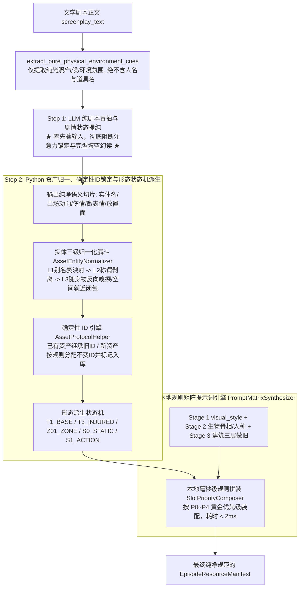

## 需求背景与问题诊断
针对阶段 6（`stage6_asset_truth`）在视听资产真理源提纯过程中，因在提示词中传入上游全量角色白名单、场景白名单、向量召回候选库以及包含实体名单的本地代码预扫描线索，引发大模型“完型填空强迫症”与“台词口头提及弱关联联想”，导致抽取到本集未登场幽灵资产（如未出场角色、未发生的宏观场景）的系统性缺陷，重构当前“大模型单次一步到位”的处理方式。

## 核心业务保障目标
1. **真实出场与自动新增入库**：大模型采用零先验（Zero-Prior）纯剧本盲抽，从物理源头绝杀幽灵资产；对当集真实登场但数据库未建档的新实体，自动识别并规范化标记增量入库；
2. **多主要形态自动派生**：通过剧情语义状态机，精准提取并自动派生主要形态（角色基础底模、战损分支、手部特写；场景全景 Wide、局部子机位 Zone；道具完好底模 S0、破坏动作态 S1）；
3. **全局统一确定性 ID 继承**：同名资产跨集跨次生成保证 100% 确定唯一的四段式不可变 ID，已有资产稳定继承，新资产按哈希/拼音规范分配；
4. **单次 LLM 配合本地矩阵毫秒级生成提示词**：全流程维持 1 次大模型调用（专注剧本语义提纯与剧情物理切片），由本地 Python 提示词矩阵引擎毫秒级合成影视级生图 Prompt，严格遵循 Token 黄金位置优先级排序，融合镜头焦段（85mm/35mm/100mm）、国别民族特征锁定（中国人/东亚脸、韩国人）、具象时代建筑材质（80年代红砖筒子楼、斑驳水泥阳台）与全剧 `visual_style`，彻底杜绝 `[visual_style]` 等未展开占位符。
5. **预扫描隐蔽幻读根治**：彻底剥离 Prompt 中的实体名单（`characters_detected` 等），仅向模型注入纯物理环境影调（光照、气候、时间）；完整的正则扫描成果完整沉淀为 Python 代码后端别名消歧与后验核验基底。


## 技术选型
- **执行环境**：Python 3.13 + Pydantic v2 + 正则表达式引擎 + LangGraph MasterState
- **设计模式**：解耦式三步子流水线（Zero-Prior Extraction & Code-Driven Synthesis Pipeline）
- **性能约束**：端到端单次 LLM 调用（耗时无新增），本地规则矩阵引擎组装耗时 < 5ms，API 额外消耗为 0

## 架构与核心流程设计



## 关键技术决策与落地细节

### 1. Prompt 彻底净化与 Scanner 实体名单剥离
- 在 `master_sop_prompts.py` 中重塑 `STAGE6_USER_PROMPT_TEMPLATE` 与 `STAGE6_SYSTEM_PROMPT`：
  - 彻底剔除 `characters_engine_json`、`environments_props_json`、`reusable_candidate_assets_json`；
  - 改造原 `scanner_pre_analysis_summary` 为 `physical_environment_cues`，仅向大模型提供全局光照（如暴雨夜、微弱烛光、逆光），严禁向提示词注入任何被识别的角色、场景、道具名称；
  - 原 `scanner_result`（含 `character_alias_map`、动宾道具、生理特写线索）完整保留在 Python 后端内部，专用于 Step 2 代码级归一化与校验。

### 2. 三级降级实体归一化算法（AssetEntityNormalizer）
- **Level 1（别名映射表）**：利用 `scanner_result.character_alias_map` 及全局资产库已登记 aliases 精确命中（如“老沈”直接映射至“沈炼”）；
- **Level 2（称谓剥离与包含匹配）**：正则清洗常见职衔与称谓（“沈大人”/“锦衣卫沈炼” -> 提取核心名“沈炼”）；
- **Level 3（随身挂载物反向嗅探与空间就近闭包）**：
  - 大模型盲抽到泛化道具（如“药丸”、“刀”），反向嗅探当前角色随身资产库（沈炼随身带着“解药/绣春刀”），自动归一绑定已有资产；
  - 大模型盲抽到弱空间词（如“走入室内”、“转角铁梯”），就近继承当前主场景（归入主场景子机位 `Z01_ZONE`）。

### 3. 跨集跨次确定性不变 ID 引擎（AssetProtocolHelper）
- 已建档资产：100% 继承数据库全局 ID；
- 新登场资产：采用大写英文/拼音 Token + 统一四段式规则：`[CATEGORY]_[TOKEN]_[TIER]_[FUNCTION]`，计算过程采用确定性哈希或标准拼音字典，确保同一个资产在第 1 集与第 10 集生成的 ID 字节级一致。

### 4. 黄金优先级规则矩阵生图提示词合成引擎（PromptMatrixSynthesizer）
- 严格遵循现代生图/视频模型 Token 黄金位置衰减规律，实施五级插槽拼装（Slot-Priority Composition）：
  - **Slot 0 [P0: 核心主体与人种防漂移]**：读取 Stage 2 骨相与 ethnicity 设定，强行前置写入 `Authentic Chinese face, East Asian ethnicity, natural Chinese eyelids and skin texture` 或 `Korean ethnicity`，在第 1~15 个 Token 彻底压制底模西方化偏见；
  - **Slot 1 [P1: 时代世界观与具象空间材质]**：读取 Stage 1 年代世界观与 Stage 3 建筑三层做旧，具象解构时代物证（如 80 年代中国厂区建筑：`1980s mainland China, red-brick workers residential building (筒子楼), weathered cement corridor, peeling green paint on walls, hanging laundry on wire line`）；
  - **Slot 2 [P2: 剧情微观物理动态与战损]**：插入 Step 1 大模型盲抽提取的当集动作、伤情（`left arm wounded with dark red blood, wet fabric`）；
  - **Slot 3 [P3: 摄影光学与构图视角]**：自动根据形态规格注入焦段（角色立绘 85mm f/1.4，场景机位 35mm 变形宽银幕，手持道具 100mm 微距）；
  - **Slot 4 [P4: 全局视觉影调与渲染底色]**：提取 Stage 1 真实的 `visual_style` 字符串进行具象展开，拼接 `--style raw` 等引擎参数，彻底消灭 `[visual_style]` 等占位符。

## 目录结构变更清单

```
python-backend/
├── app/
│   ├── workflows/
│   │   ├── nodes/
│   │   │   └── stage6_asset_truth.py        # [MODIFY] 重构主执行节点：实现Step 1纯剧本零先验盲抽、Step 2实体三级归一与状态机多形态派生、Step 3本地提示词矩阵合成流水线，实现新资产增量入库标记。
│   │   ├── prompts/
│   │   │   └── master_sop_prompts.py        # [MODIFY] 净化 STAGE6_USER_PROMPT_TEMPLATE 与 STAGE6_SYSTEM_PROMPT，彻底剔除先验资产库与实体名单注入，建立纯剧本语义切片输出契约。
│   │   └── utils/
│   │       ├── asset_protocol.py            # [MODIFY] 升级 AssetProtocolHelper，完善确定性不变 ID 生成、别名解析与四段式标准命名函数。
│   │       └── prompt_synthesizer.py        # [MODIFY] 扩展实现 PromptMatrixSynthesizer，按 P0~P4 黄金优先级与时代/人种材质字典实现毫秒级生图 Prompt 矩阵装配。
└── tests/
    └── unit/
        ├── test_stage6_three_stage_pipeline.py  # [NEW] 阶段6三步协同流水线专属单元测试套件：验证零实体泄露、台词虚指抗幻读、三级别名归一、跨集确定性ID、多形态派生与P0~P4提示词规格。
        └── test_stage6_extraction_quality.py    # [MODIFY] 适配新契约，确保全量回归用例通过。
```


## Agent Extensions
### SubAgent
- **code-explorer**
  - Purpose: 探查 `stage6_asset_truth.py` 与 `asset_protocol.py` 中的现有状态字段、回退工厂及数据契约边界
  - Expected outcome: 确保流水线改造完全兼容下游阶段 7（分镜生成节点）与全局数据库 Checkpoint
