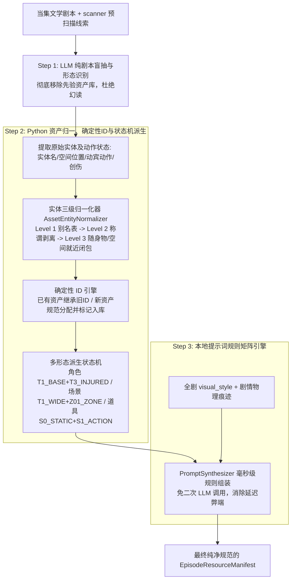

## 需求概述
针对阶段 6（`stage6_asset_truth`）在资产抽取过程中由于传入上游全量角色白名单、场景白名单与候选资产库导致的大模型先验污染与幻读问题（抽取到本集未登场角色/场景/道具），重构当前“大模型单次一步到位”的处理方式。将其解耦为“Python 代码协同的三步流水线”，满足以下四大核心业务目标：
1. **真实出场与自动新增**：仅抽取本集真实出场的角色、场景、道具，未录入数据库的新实体自动识别并触发入库；
2. **多主要形态自动派生**：精准提取实体在当集的主要形态（角色基础/战损/手部特写，场景全景/子机位Zone，道具完好底模S0/破损态S1）；
3. **全局统一确定性 ID 继承**：抽取的资产 ID 严格遵循规范算法，同一资源跨集跨次生成保持绝对确定与一致；
4. **提示词全剧风格与剧情深度对齐**：文生图与图生图提示词深度融合全剧视觉风格（`visual_style`）、镜头焦段与当集剧情感官细节，彻底杜绝占位符与模板废话。

## 核心功能表现
- **输入净化**：大模型 Prompt 彻底切除非出场先验资产定义，阻断完型填空强迫症；
- **三级实体归一化**：通过别名映射、称谓剥离、随身物/空间闭包匹配解决代称与同义词对齐，防止重复建档；
- **确定性状态机**：由 Python 逻辑根据剧情动作与伤情状态机，自动派生标准多形态资产与四段式 ID；
- **零延迟提示词矩阵**：由本地 Python 提示词合成器在毫秒级内完成高质量机位参数与剧情痕迹组装。


## 技术选型与总体架构
- **语言与框架**：Python 3.13 + Pydantic v2 + LangGraph / LangChain 状态机
- **架构模式**：解耦式三步子流水线（Zero-Prior Extraction & Code-Driven Normalization Pipeline）
  - **Step 1 (LLM 零先验剧情盲抽)**：大模型专注纯语义理解，仅从剧本文本抽取活跃实体、动作行与物理状态；
  - **Step 2 (Python 确定性归一与状态机)**：通过实体三级漏斗（别名映射 -> 称谓剥离 -> 随身物/空间闭包）对齐已有资产，采用确定性拼音/哈希规则分配不变 ID，由状态机派生多级形态；
  - **Step 3 (PromptSynthesizer 规则矩阵引擎)**：本地毫秒级合成影视级生图 Prompt（85mm/35mm/100mm、战损、剧情物理痕迹）。



## 关键技术决策与弊端防御机制
1. **彻底清理 Prompt 避免先验污染**：在 `STAGE6_USER_PROMPT_TEMPLATE` 中移除 `characters_engine_json`、`environments_props_json`、`reusable_candidate_assets_json`，消除大模型在注意力机制下的完型填空强迫症。
2. **防代称重复建档（三级逐级降级对齐算法）**：
   - Level 1：全剧已知资产全名/别名表（`character_alias_map` + 数据库已登记 aliases）精准命中；
   - Level 2：称谓词（大人、掌柜、刺客、公公）正则剥离与核心子串包含比对；
   - Level 3：随身挂载物反向嗅探（通用“药丸/刀”自动绑定角色随身物“解药/绣春刀”）与空间就近闭包（弱空间词自动挂载为主场景子机位）。
3. **消除二次 LLM 调用延迟**：提示词生成不进行二次网络大模型请求，由 Python 本地 `PromptSynthesizer` 规则矩阵组装，执行耗时小于 5ms，API 消耗为 0。
4. **统一确定性 ID 生成**：基于 `AssetProtocolHelper`，采用大写英文/拼音 Token + 统一四段式命名规则，同一个资产名称在不同集数运行生成的 ID 保持 100% 确定且不变。

## 目录结构变更清单

```
python-backend/
├── app/
│   ├── workflows/
│   │   ├── nodes/
│   │   │   └── stage6_asset_truth.py        # [MODIFY] 重构阶段6主执行节点，实现Step 1盲抽调用、Step 2 Python实体三级归一与状态机多形态派生、Step 3本地提示词合成与状态机入库标记流水线。
│   │   ├── prompts/
│   │   │   └── master_sop_prompts.py        # [MODIFY] 净化 STAGE6_USER_PROMPT_TEMPLATE 与 STAGE6_SYSTEM_PROMPT，去除先验资产注入，建立纯剧本实体与物理状态抽取契约。
│   │   └── utils/
│   │       ├── asset_protocol.py            # [MODIFY] 强化 AssetProtocolHelper，提供确定性 ID 继承与标准新 ID 分配算法，严格保证跨集一致性。
│   │       └── prompt_synthesizer.py        # [MODIFY] 升级提示词规则矩阵引擎，支持根据派生形态（T1/T2/T3/Zone/S0/S1）自动组装焦段、构图、剧情物理痕迹与全剧画风。
└── tests/
    └── unit/
        ├── test_stage6_three_stage_pipeline.py  # [NEW] 阶段6三步协同流水线专用测试套件，全面覆盖零先验盲抽、实体三级归一、确定性ID一致性、形态派生与提示词矩阵。
        └── test_stage6_extraction_quality.py    # [MODIFY] 适配新三步流水线接口，验证无幽灵出场与自动补录。
```


## Agent Extensions
### SubAgent
- **code-explorer**
  - Purpose: 快速扫描现有 `stage6_asset_truth.py` 与 `asset_protocol.py` 中的关键数据契约与 ID 生成辅助函数。
  - Expected outcome: 确保代码修改精准对接既有数据结构，避免破坏下游阶段 7（分镜生成）的数据契约。
