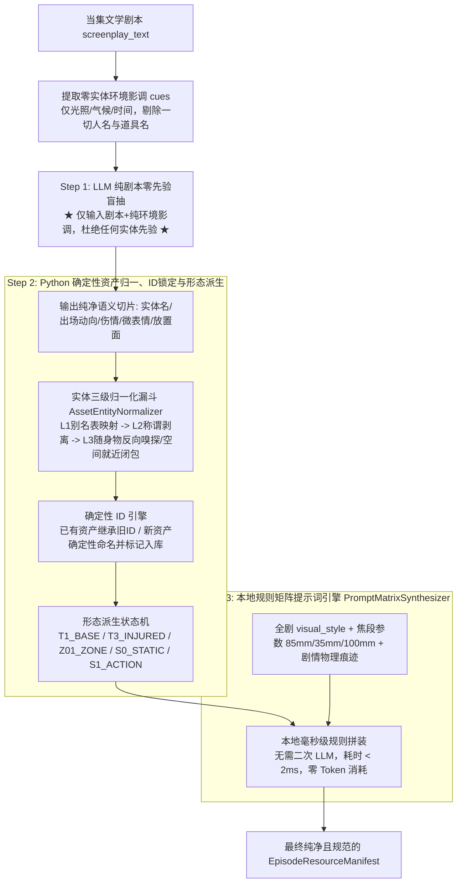

## 需求概述与问题诊断
针对阶段 6（`stage6_asset_truth`）在资产抽取过程中因为在提示词中传入了上游全量角色白名单、场景白名单、向量召回候选库以及包含实体名单的本地预扫描摘要，引发大模型“完型填空强迫症”与“台词口头提及弱关联联想”，导致抽取到本集未登场幽灵资产的问题，给出彻底的解决方案并重构为高可靠性的工业级流水线。

## 核心功能表现与业务保障
1. **真实出场与自动新增**：从源头阻断先验污染，大模型仅对当集文学剧本做无干扰盲抽；未在数据库建档的当集真实登场新实体，自动识别并规范化标记入库。
2. **多主要形态自动派生**：通过剧情语义状态机，精准提取并自动派生主要形态（角色基础底模、战损分支、手部特写；场景全景Wide、局部子机位Zone；道具完好底模S0、破坏动作态S1）。
3. **全局统一确定性 ID 继承**：同名资产跨集跨次执行保证生成 100% 确定唯一的四段式不可变 ID，已有资产稳定继承，新资产按哈希/拼音规范分配。
4. **单次 LLM 配合本地矩阵毫秒级生成提示词**：全流程仅调用 1 次大模型（专注剧本语义提纯），由本地 Python 提示词矩阵引擎毫秒级合成影视级生图 Prompt，融合镜头焦段（85mm/35mm/100mm）、空间残留、战损肌理与 `visual_style`，彻底杜绝 `[visual_style]` 等未展开占位符。


## 技术选型与总体架构
- **技术栈**：Python 3.13, Pydantic v2, 正则/状态机引擎, 向量/哈希协议
- **架构方案**：零先验三步解耦流水线（Zero-Prior Extraction & Code-Driven Synthesis Pipeline）

### 1. 核心架构设计与数据流图



### 2. 两个关键疑问的最优工程落地策略

#### 策略一：`scanner_pre_analysis_summary` 导致的隐蔽幻读根治
- **根因消除**：原预扫描摘要中包含 `characters_detected`、`scenes_detected`、`props_detected`。如果剧本台词提及“魏忠贤”，正则预扫描器会将其列为 detected 实体，大模型误将其视为权威出场事实，从而导致幻读。
- **治理方案**：对送入 Prompt 的参数进行彻底净化：
  - 新增 `extract_pure_physical_environment_cues(scanner_result)` 纯净提取函数，**仅输出光影（如暴雨夜、微弱烛光）与气候**；
  - **严禁向 Prompt 注入任何角色名、场景名与道具名清单**；
  - 原完整的 `scanner_result`（含 `character_alias_map`、动宾短语）完整保留在 **Python 后端内部**，作为 Step 2 实体归一化和 Step 3 环境参数补齐的依据，不暴露给大模型。

#### 策略二：单次大模型调用下的专业提示词毫秒级合成
- **保持 1 次大模型调用**：大模型仅负责语言理解，输出各实体的“剧情物理切片”（如沈炼“左臂刀伤渗血、咬紧后槽牙”；客栈“生锈铁梯旁、地面雨水泥泞”；腰牌“放置在斑驳八仙桌上”）。
- **本地规则矩阵引擎组装（PromptMatrixSynthesizer）**：
  $$\text{Prompt} = \text{实体核心DNA} + \text{形态摄影焦段(85mm/35mm/100mm)} + \text{剧情物理痕迹} + \text{世界观影调} + \text{接地软阴影}$$
  在本地 Python 字符串级别毫秒级装配，100% 消除二次 LLM 带来的 8~10 秒系统延迟与网络故障率，且彻底消灭 `[visual_style]` 等未展开占位符。

---

## 目录结构与变更清单

```
python-backend/
├── app/
│   ├── workflows/
│   │   ├── nodes/
│   │   │   └── stage6_asset_truth.py        # [MODIFY] 重构阶段6主执行逻辑：移除先验实体输入，改为物理环境线索注入，实现Step 2实体三级归一、确定性ID分配、状态机形态派生与增量落库标记，串联流水线。
│   │   ├── prompts/
│   │   │   └── master_sop_prompts.py        # [MODIFY] 净化 STAGE6_USER_PROMPT_TEMPLATE 与 STAGE6_SYSTEM_PROMPT，彻底移除 characters_engine、environments_props、candidates 与实体扫描列表，确立纯剧本语义切片输出契约。
│   │   └── utils/
│   │       ├── asset_protocol.py            # [MODIFY] 在 AssetProtocolHelper 中实现确定性 ID 算法（规范化清洗、大写拼音/哈希 Token + 四段式规则），保证跨集跨次生成一致。
│   │       └── prompt_synthesizer.py        # [MODIFY] 扩展 PromptSynthesizer，实现 PromptMatrixSynthesizer 本地规则矩阵引擎，支持人像 85mm、全景 35mm 变形镜头、微距 100mm 及剧情物理痕迹毫秒级硬装配。
└── tests/
    └── unit/
        ├── test_stage6_three_stage_pipeline.py  # [NEW] 针对零先验三步流水线的专属单元测试套件：覆盖零实体泄露、台词虚指抗幻读、三级别名归一化、跨集ID确定性、形态自动派生与零占位符提示词矩阵。
        └── test_stage6_extraction_quality.py    # [MODIFY] 适配新契约，确保既有质量与回归测试全绿通过。
```


## Agent Extensions
### SubAgent
- **code-explorer**
  - Purpose: 快速探查 `stage6_asset_truth.py` 与 `asset_protocol.py` 中现有的 ID 生成与 MasterState 状态更新链路
  - Expected outcome: 确保新三步流水线平滑对接下游阶段 7（分镜生成节点）与全局数据库 Checkpoint
