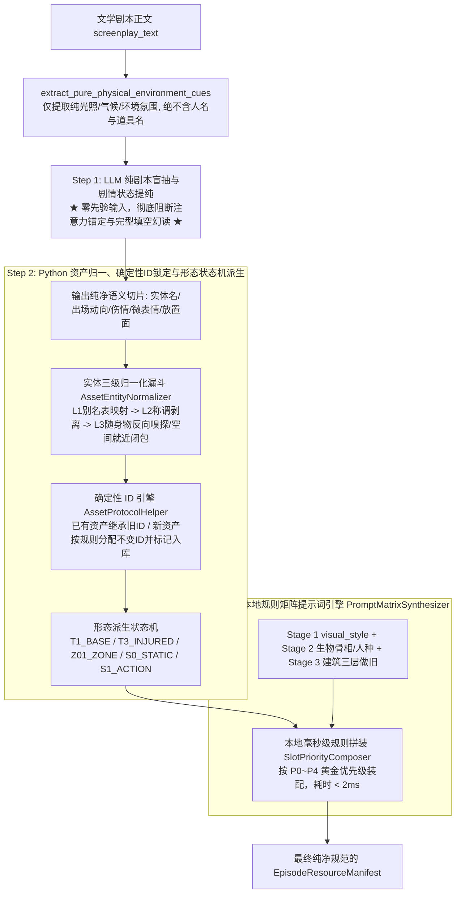

## 需求背景与问题诊断
阶段 6（`stage6_asset_truth`）在视听资产真理源提纯过程中，因在提示词中传入上游全量角色白名单、场景白名单、向量召回候选库以及包含实体名单的本地代码预扫描线索，引发大模型“完型填空强迫症”与“台词口头提及弱关联联想”，导致抽取到本集未登场幽灵资产（如仅在台词中被提及的虚指角色、未发生的宏观场景）。本方案将高阶架构（零先验盲抽、状态机派生、黄金插槽矩阵）与工程设计规范（Pydantic 数据契约、三级漏斗具体正则、四段式 ID、P0~P4 字典）深度融合，构建无歧义、可直接落地的阶段 6 三步流水线。

## 核心业务保障目标
1. **真实出场与自动新增入库**：大模型采用零先验（Zero-Prior）纯剧本盲抽，从物理源头绝杀幽灵资产；对当集真实登场但数据库未建档的新实体，自动识别并规范化标记增量入库；
2. **多主要形态自动派生**：通过剧情语义状态机，精准提取并自动派生主要形态（角色基础底模 `T1_BASE`、战损分支 `T3_STATUS_INJURED`、手部特写 `T3_MACRO_HAND`；场景全景 `T1_WIDE`、局部子机位 `Z01_ZONE`；道具完好底模 `S0_STATIC`、破坏动作态 `S1_ACTION`）；
3. **全局统一确定性 ID 继承**：同名资产跨集跨次生成保证 100% 确定唯一的四段式不可变 ID，已有资产稳定继承，新资产按哈希/拼音规范分配；
4. **单次 LLM 配合本地矩阵毫秒级生成提示词**：全流程维持 1 次大模型调用（专注剧本语义提纯与剧情物理切片），由本地 Python 提示词矩阵引擎毫秒级合成影视级生图 Prompt，严格遵循 Token 黄金位置优先级排序，融合镜头焦段（85mm/35mm/100mm）、国别民族特征锁定（中国人/东亚脸、韩国人）、具象时代建筑材质（80年代红砖筒子楼、斑驳水泥阳台）与全剧 `visual_style`，彻底杜绝 `[visual_style]` 等未展开占位符；
5. **预扫描隐蔽幻读根治**：彻底剥离 Prompt 中的实体名单（`characters_detected` 等），仅向模型注入纯物理环境影调（光照、气候、时间）；完整的正则扫描成果完整沉淀为 Python 代码后端别名消歧与后验核验基底。


## 技术选型与总体架构
- **执行环境**：Python 3.13 + Pydantic v2 + 正则表达式引擎 + LangGraph MasterState
- **架构方案**：零先验三步解耦流水线（Zero-Prior Extraction & Code-Driven Synthesis Pipeline）
- **性能指标**：大模型网络调用严格保持 1 次（零新增延迟与 Token 膨胀），本地规则矩阵引擎组装耗时 < 5ms。



## 工程级设计规范与落地细节

### 1. Prompt 彻底净化与数据契约规范（`master_sop_prompts.py`）
- **Prompt 模板重构**：彻底切除 `{characters_engine_json}`、`{environments_props_json}`、`{reusable_candidate_assets_json}`，将 `{scanner_pre_analysis_summary}` 改造为无任何实体名单的 `{physical_environment_cues}`；
- **大模型单次返回 JSON Schema 契约**：
  - `extracted_characters`: 包含 `raw_name`（文本名称）、`appearance_type`（`DIALOGUE_AND_ACTION` / `ACTION_ONLY`）、`current_motion`（动作）、`physical_wounds`（伤情）、`emotional_expression`（表情）；
  - `extracted_environments`: 包含 `raw_name`（场景名）、`sub_zone_spot`（局部机位）、`scene_traces`（物理残留痕迹）；
  - `extracted_props`: 包含 `raw_name`（道具名）、`associated_character`（交互角色）、`placement_surface`（承载底座）、`damage_state`（`INTACT` / `DAMAGED`）。

### 2. Python 实体三级归一化漏斗（`AssetEntityNormalizer`）
在 `stage6_asset_truth.py` 中实现：
- **Level 1（别名映射表）**：利用 `scanner_result.character_alias_map` 及全局已建档资产别名精确命中（如“老沈”直接对齐“沈炼”）；
- **Level 2（称谓剥离与双向包含）**：正则清洗常见职衔与称谓 `r"^(锦衣卫|东厂|提督|大人|掌柜|刺客|头领|老|小)"`，提取核心名双向包含匹配；
- **Level 3（随身挂载物反向嗅探与空间就近闭包）**：
  - 泛化道具（“刀”、“药丸”）结合交互角色反向嗅探 Stage 2 角色随身物品，对齐已有核心资产；
  - 弱空间词（“走廊”、“暗角”）就近绑定到当集主场景作为其子机位；
- **增量入库打标**：对未命中的真实出场实体标记 `is_new=True`，提取基础属性并回写全局 `state.characters_engine` / `state.environments_and_props`。

### 3. 跨集跨次确定性不可变 ID 引擎（`AssetProtocolHelper`）
在 `asset_protocol.py` 中扩展：
- 已建档资产：100% 继承全局已有 ID；
- 新建档资产：调用 `generate_deterministic_id(category, name, form_tag)`，通过中文转大写拼音/哈希 Token 与标准四段式规范：
  - 角色：`CHAR_<TOKEN>_T1_BASE` / `CHAR_<TOKEN>_T3_STATUS_INJURED` / `CHAR_<TOKEN>_T3_MACRO_HAND`
  - 场景：`ENV_<TOKEN>_T1_WIDE` / `ENV_<TOKEN>_Z01_ZONE`
  - 道具：`PROP_<TOKEN>_S0_STATIC` / `PROP_<TOKEN>_S1_ACTION`
  - 确保同一资产在任意集数执行均产出字节级完全相同的确定性 ID。

### 4. 黄金优先级规则矩阵生图提示词合成引擎（`PromptMatrixSynthesizer`）
在 `prompt_synthesizer.py` 中实现 `PromptMatrixSynthesizer`，遵循 Diffusion / Flow-Matching 模型 Token 黄金位置衰减规律，按 P0~P4 优先级装配：
- **Slot 0 [P0: 核心主体人种/国籍防漂移]**：读取 Stage 2 骨相与 ethnicity 设定，强行前置写入 `Authentic East Asian Chinese face, natural skin texture, distinct Chinese facial features` 或对应国籍面孔词包，压制西方底模偏见；
- **Slot 1 [P1: 时代世界观与具象空间做旧]**：读取 Stage 1 年代世界观与 Stage 3 建筑三层做旧，具象解构时代物证（如 80 年代中国厂区建筑：`1980s mainland China, red-brick workers residential building (筒子楼), weathered cement corridor, peeling green paint on walls, hanging laundry on wire line`）；
- **Slot 2 [P2: 剧情微观物理动态与战损]**：插入 Step 1 大模型抽取的当集动作、伤情（`left arm wounded with dark red blood, wet fabric`）；
- **Slot 3 [P3: 摄影光学与构图视角]**：自动根据派生形态注入焦段（立绘 85mm f/1.4，场景 35mm 变形宽银幕，道具 100mm 微距）；
- **Slot 4 [P4: 全局视觉影调与渲染底色]**：提取 Stage 1 真实的 `visual_style` 字符串进行具象展开，拼接 `--style raw` 等引擎参数，彻底消灭 `[visual_style]` 等未展开占位符。

## 目录结构变更清单

```
python-backend/
├── app/
│   ├── workflows/
│   │   ├── nodes/
│   │   │   └── stage6_asset_truth.py        # [MODIFY] 重构主执行节点：实现纯剧本环境线索抽取、实体三级漏斗归一、多形态状态机派生、增量入库回写与最终 Manifest 组装。
│   │   ├── prompts/
│   │   │   └── master_sop_prompts.py        # [MODIFY] 净化 STAGE6_USER_PROMPT_TEMPLATE 与 STAGE6_SYSTEM_PROMPT，剔除先验资产库与实体名单，建立纯剧本语义切片输出契约。
│   │   └── utils/
│   │       ├── asset_protocol.py            # [MODIFY] 升级 AssetProtocolHelper，实现确定性跨集四段式不可变 ID 生成器 generate_deterministic_id。
│   │       └── prompt_synthesizer.py        # [MODIFY] 实现 PromptMatrixSynthesizer，按 P0~P4 黄金插槽组装具象人种面孔、80年代建筑做旧与光学焦段，消灭占位符。
└── tests/
    └── unit/
        ├── test_stage6_three_stage_pipeline.py  # [NEW] 阶段6零先验三步流水线专属单元测试套件：覆盖零实体泄露、台词虚指抗幻读、三级别名归一、跨集确定性ID、多形态派生与P0~P4提示词规格。
        └── test_stage6_extraction_quality.py    # [MODIFY] 适配新契约，确保既有质量与回归测试全绿通过。
```


## Agent Extensions
### SubAgent
- **code-explorer**
  - Purpose: 探查 `stage6_asset_truth.py` 与 `asset_protocol.py` 中既有数据回退逻辑、字段边界与 MasterState 状态更新链路
  - Expected outcome: 确保改造过程不破坏既有数据结构，与下游 Stage 7 分镜节点零摩擦对接
