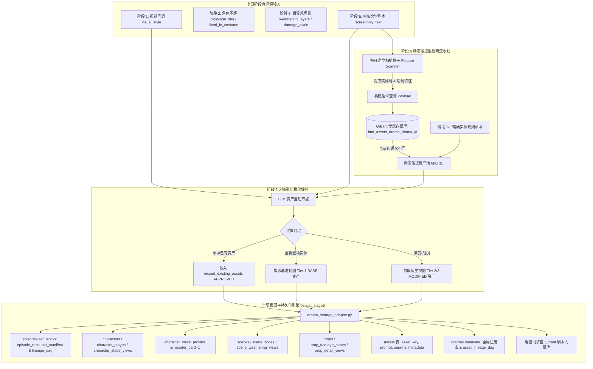
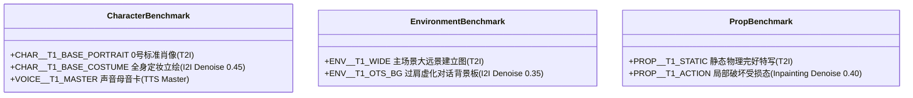

# 阶段 6 资产存储与向量资产召回端到端改进方案

> **文件路径**: `docs/plans/2026-10-09-stage6-asset-storage-and-vector-recall-plan.md`  
> **创建日期**: 2026-10-09  
> **目标**: 彻底解决长篇短剧（30~100集）在阶段 6（视听真理源资产提纯）中因历史资产累积引发的 **Prompt Token 爆炸** 问题，结合 **高范式多级资产关系存储** 与 **Qdrant 分剧隔离向量候选池召回**，实现视听资产的低成本、高一致性、全生命周期闭环管理。

---

## 一、 现状痛点与重构目标

### 1.1 现状痛点
1. **Prompt Token 随集数线性甚至指数级膨胀**：
   - 现有阶段 6 节点在提取单集视听资产时，将全剧所有历史角色、场景、道具（涵盖各集换装、战损变体）一次性塞入大模型上下文。
   - 当剧集推进到第 30 集以上时，历史资产数达到数百项，单次提示词开销激增至数万 Token，不仅推理成本极高、延迟大，还极易导致大模型注意力涣散（Lost in the Middle），产生幻觉漏判或虚假新增资产。
2. **资产存储血统链存在缺失**：
   - 数据库已通过迁移脚本扩展了 `assets` 统管表字段（`asset_key`, `prompt`, `params`, `metadata`）、角色母卡标记 `is_master_card`、造型阶段继承链 `parent_stage_id` 以及道具战损演化链 `parent_state_id`。
   - 但底层适配层 `persist_stage6` 尚未完整实现对 `assets` 统管表的写入，导致单元测试 `tests/unit/test_stage6_full_persistence_enhancements.py` 失败，资产跨集追溯存在断点。
3. **上游世界观资产（阶段 2、3）与动态视听资产断层**：
   - 阶段 2（角色圣经）与阶段 3（环境与物证世界观）产出的高精度设定（骨相生物学、生活质感服化道密码、场景做旧图层）未形成统一的资产向量索引，使得阶段 6 在识别登场实体时缺乏高效的基准检索通路。

### 1.2 重构目标
1. **输入 Token 规模由 $O(N_{\text{全量资产}})$ 降为有界常数 $O(K_{\text{候选池}})$**：
   - 单集上下文中的候选资产严格控制在 **10 ~ 15 项**（约 500 ~ 800 Tokens），无论全剧已有 10 个还是 1000 个资产，阶段 6 的推理成本与上下文长度恒定。
2. **100% 物理级剧本隔离，彻底杜绝跨剧资产污染**：
   - 依托 Qdrant 的分剧 Collection（`lmd_assets_drama_{drama_id}`）与 Payload 过滤，实现多剧本并发环境下的绝对数据隔离。
3. **高范式关系存储与血统 DAG 全生命周期对齐**：
   - 全面落地角色（`characters` -> `character_stages` -> `character_stage_views`）、场景（`scenes` -> `scene_zones` -> `scene_weathering_views`）、道具（`props` -> `prop_damage_states` -> `prop_detail_views`）及素材统管（`assets`）的多级关系模型与单集血统 DAG。
4. **规范化全新实体基准视图（Tier 1 Benchmark Views）提取机制**：
   - 当第 $N$ 集首次出现全新实体时，自动执行“文生基准图（0号肖像/主场景全景/静态道具） + 图生衍生图（全身立绘/虚化背景/形变动作）”的确定性流水线。

---

## 二、 整体系统架构与工作流拓扑

系统采用 **“双轨驱动：关系型强约束存储 + 向量语义动态召回”** 的复合架构。



---

## 三、 详细技术方案设计

### 3.1 资产存储与血统链路规范（Storage & Lineage Model）

#### 1. 核心关系表存储矩阵

| 业务领域 | 核心主表及字段 | 从表及层级关系 | 阶段 6 提取基准时落库规范 |
| :--- | :--- | :--- | :--- |
| **角色资产** | `characters`<br>- `id`, `drama_id`<br>- `character_code` (如 `CHAR_LUCHEN`)<br>- `name`, `gender`, `role`<br>- `appearance`, `identity_anchors` | `character_stages` (造型阶段)<br>- `stage_code`<br>- `parent_stage_id`<br>- `costume_description`<br>`character_stage_views` (切片图)<br>- `view_type`: `main_portrait`, `four_view`<br>- `image_prompt`, `is_primary` | 1. 首次登场角色自动建档写入 `characters`；<br>2. 建立该集造型阶段写入 `character_stages`，维护 `parent_stage_id`；<br>3. 0号正面肖像 Prompt 写入 `character_stage_views` (`main_portrait`)；<br>4. 写入 `episode_characters` 多对多绑定。 |
| **声音资产** | `character_voice_profiles`<br>- `character_id`, `drama_id`<br>- `voice_id` (如 `VOICE_LUCHEN_T1_MASTER`)<br>- `timbre`, `voice_prompt`<br>- `speed_ratio`, `pitch_ratio`<br>- `is_master_card` (1=全剧母卡, 0=分集临时) | 无（扁平化音频配置） | 1. 新角色写入时标记 `is_master_card = 1`；<br>2. 记录发声腔体、气泡音瑕疵及单集高光台词采样。 |
| **场景资产** | `scenes`<br>- `id`, `drama_id`, `episode_id`<br>- `location` (场景名)<br>- `time`, `prompt` | `scene_zones` (空间子区域)<br>- `zone_name`, `time_lighting`<br>`scene_weathering_views` (做旧层)<br>- `layer_type`, `description`<br>- `visual_prompt`, `is_locked_truth` | 1. 新场景记录入库 `scenes`；<br>2. 默认创建主活动区 `scene_zones`；<br>3. 气候做旧图层写入 `scene_weathering_views`。 |
| **道具资产** | `props`<br>- `id`, `drama_id`<br>- `name` (物证名), `type`<br>- `description`, `prompt` | `prop_damage_states` (损坏演化)<br>- `state_label`, `damage_level`<br>- `parent_state_id` (父状态指针)<br>- `narrative_point`<br>`prop_detail_views` (微观切片)<br>- `view_type`: `macro_feature` | 1. 新道具记录入库 `props`；<br>2. 初始完好态及战损态写入 `prop_damage_states`，严格维护 `parent_state_id` 继承树；<br>3. 细节特写 Prompt 写入 `prop_detail_views`。 |
| **素材统管** | `assets`<br>- `asset_key` (四段式 ID，如 `CHAR_LUCHEN_T1_BASE_PORTRAIT`)<br>- `name`, `type` (`image`/`audio`/`video`)<br>- `category` (`character`/`scene`/`prop`)<br>- `prompt`, `negative_prompt`<br>- `params` (JSON: `denoising_strength`, `input_source_image`)<br>- `metadata` (JSON: `parent_asset_id`, `episode_num`) | 统一主素材库，承载生图/生音引擎所需全量工程参数 | 阶段 6 识别出的所有 `newly_generated_assets` 及其伴生母音卡，**必须全量写入 `assets` 表**。 |

#### 2. 快照与血统图谱存储（Dual Snapshots）
* **单集快照：`episodes.ast_blocks['episode_resource_manifest']`**
  * 固化保存当前集完整资源清单、`reused_existing_assets`、`newly_generated_assets` 与单集局部依赖图 `lineage_dag`。
* **全剧血统总图：`dramas.metadata['asset_lineage_dag']`**
  * 聚合合并全剧所有集数的资产依赖关系，形成跨集的全局有向无环图，例如：
    ```json
    {
      "CHAR_LUCHEN_T1_BASE_COSTUME": "CHAR_LUCHEN_T1_BASE_PORTRAIT",
      "CHAR_LUCHEN_T2_4V_FRONT": "CHAR_LUCHEN_T1_BASE_COSTUME",
      "PROP_SEAL_T1_ACTION": "PROP_SEAL_T1_STATIC"
    }
    ```

---

### 3.2 向量资产召回方案（Vector Recall & Candidate Pool Pipeline）

#### 1. 物理隔离集合命名与 Payload 结构
* **集合命名**：固定为 `lmd_assets_drama_{drama_id}`。
* **向量维度与算法**：1536 维，余弦距离（Cosine Metric）。
* **Payload 元数据架构**：
  ```json
  {
    "drama_id": 888,
    "asset_id": "CHAR_LUCHEN_T1_BASE_PORTRAIT",
    "category": "character",
    "entity_name": "陆沉",
    "tier": "T1",
    "function_type": "BASE_PORTRAIT",
    "visual_features": "高颧骨方正下颌，左眉断痕，黑发微卷，自然粗糙毛孔",
    "costume_summary": "重磅粗花呢大衣，做旧磨损皮靴",
    "lifecycle_status": "APPROVED",
    "created_episode": 1
  }
  ```

#### 2. 阶段 2 与阶段 3 的“零号设定（Tier 0 Canon）”注入
在剧本创作前置阶段，阶段 2 与阶段 3 产出的资产即刻向量化落库：
* **Stage 2 角色注入**：以角色名、生物骨相 `biological_dna`、日常服饰 `lived_in_costume` 拼接生成向量。
* **Stage 3 场景与道具注入**：以场景名称、光影时段、做旧层 `weathering_layers` 以及道具材质、破损级别 `damage_scale` 生成向量。

#### 3. 动态候选池构建三步法（3-Step Hybrid Recall）
当执行第 $N$ 集的阶段 6 时：
1. **第一步：剧本文本扫描（Feature Scanning）**
   - 提取剧本登场角色姓名、场景 Heading（如 `## 场景1：雍亲王府书房`）、带有 `【】` 标记或特殊名词的道具、以及破坏性动词（撕/砸/烧/切等）。
2. **第二步：混合双轨召回（Hybrid Recall）**
   - **轨 1（精准规则直配）**：根据提取出的实体中文名，直接从数据库主表快速查询已有 `character_code`、`location`、`name` 对应的 T1 基准资产（精确匹配，消耗 0 向量搜索成本）。
   - **轨 2（向量语义搜索）**：将本集剧本动作段落与环境描写生成 Dense Embedding，在 `lmd_assets_drama_{drama_id}` 中进行相似度检索（Top-10，Threshold $\ge 0.65$），召回语义相关度高的历史变体与环境资产。
3. **第三步：候选池去重与有界预算（Bounded Context Pool）**
   - 合并两轨结果，按“T1 基准 > 临近集数变体 > 历史变体”的优先级排序，截断至 **最多 15 项**。
   - 格式化为极其紧凑的摘要卡片（每项仅约 40 词），注入到阶段 6 提示词的 `[历史资产候选库]` 中。

---

### 3.3 新实体基准视图（Tier 1）提取与生成管线

当大模型在阶段 6 推理时，若发现某个实体在候选库中不存在，则触发**全新实体基准视图提取管线**：



#### 1. 提示词（Prompt）三层组装算法
```text
[新实体生图 Prompt] = 
    [Layer 1: 全局视听风格 (Stage 1 visual_style)] 
    + [Layer 2: 实体设定真理 (Stage 2/3 Canon 或 Stage 5 逆向扫描提纯)] 
    + [Layer 3: 工程渲染约束 (画幅比, 8k raw photo, --style raw)]
```
* **严禁空泛形容词**：禁止出现 "handsome", "pretty", "cool" 等不可控描述；强制使用解剖级生理学词汇（骨相、毛孔、疤痕、红血丝）与材料物理学词汇（克重、氧化斑、磨损折痕）。

#### 2. 血统锁与生成方式矩阵

| 资产类型 | 资产 ID 公式 | 生成方式 (`generation_method`) | 底图 (`input_source_image`) | 面部参考锁 (`identity_reference`) | 重绘幅度 (`denoising_strength`) | 核心规范 |
| :--- | :--- | :--- | :--- | :--- | :--- | :--- |
| **角色 0 号肖像** | `CHAR_<ID>_T1_BASE_PORTRAIT` | `text_to_image` | null | null | null | 85mm中景特写，正视镜头，中性光影，作为全剧绝对人脸参考锁 |
| **角色全身定妆** | `CHAR_<ID>_T1_BASE_COSTUME` | `image_to_image` | `..._BASE_PORTRAIT` | `..._BASE_PORTRAIT` | **0.45** | 9:16 画幅，**从头顶到鞋底完整落地接地，严禁裁脚** |
| **场景大远景** | `ENV_<ID>_T1_WIDE` | `text_to_image` | null | null | null | 建立镜头（Establishing Shot），展示完整空间透视与主光源 |
| **场景过肩板** | `ENV_<ID>_T1_OTS_BG` | `image_to_image` | `..._WIDE` | null | **0.35** | 浅景深虚化板，保留光斑与漫反射，用于正反打对话 |
| **道具完好态** | `PROP_<ID>_T1_STATIC` | `text_to_image` | null | null | null | 1:1 或 9:16 微距特写，物理完好状态与微观材质质感 |
| **道具受损态** | `PROP_<ID>_T1_ACTION` | `inpainting_local_edit` | `..._STATIC` | null | **0.40** | **仅当剧本命中破坏动词时生成**，保持主体形态仅重绘受损区 |

---

## 四、 具体落地实施任务拆解（Task-by-Task Roadmap）

本方案拆分为 4 个连续阶段实施，每个步骤具备明确的修改文件、改动逻辑与验证准则：

### Phase 1: 存储适配层完善与单测修复 (Persistence Layer Enhancement)

* **目标**：修复 `persist_stage6`，使其完整支持 `assets` 表全字段落库及实体继承树，确保单测 `test_stage6_full_persistence_enhancements.py` 100% 通过。
* **改动文件**：
  - `python-backend/app/workflows/adapters/drama_storage_adapter.py`
* **具体改动**：
  1. 在 `persist_stage6` 中增加对 `assets` 表的批量插入与更新逻辑：
     - 将 `newly_generated_assets` 逐条写入 `assets` 表，映射 `asset_key = asset_id`，写入 `prompt`, `negative_prompt`, `params` (JSON), `metadata` (JSON), `type`, `category`；
     - 将 `new_character_master_voice_cards` 也作为音频资产写入 `assets` 表（`type='audio'`, `category='voice'`）。
  2. 修复 `character_stages` 的写入：支持从传入实体中提取 `stage_code` 与 `parent_stage_id`，并正确建立父子继承链。
  3. 修复 `character_voice_profiles`：母音卡插入时明确标记 `is_master_card = 1`。
  4. 修复 `prop_damage_states`：支持从传入数据中读取 `parent_state_id`（或通过 `parent_state_label` 解析），维护道具破坏演进树。
  5. 修复 `episodes.ast_blocks` 与 `dramas.metadata`：确保 `lineage_dag` 与 `reused_existing_assets` 正确保存至 AST 并在短剧元数据中合并为 `asset_lineage_dag`。
* **验证准则**：
  ```bash
  cd python-backend && .venv\Scripts\python.exe -m pytest tests/unit/test_stage6_full_persistence_enhancements.py
  ```
  执行结果必须为 `1 passed`。

---

### Phase 2: 向量服务接口扩展与剧本隔离优化 (Vector Service Optimization)

* **目标**：在 `VectorMemoryService` 中建立专用的资产召回与入库专用管道，封装候选资产召回算法。
* **改动文件**：
  - `python-backend/app/context/vector_memory_service.py`
* **具体改动**：
  1. 增加专门接口 `sync_assets_to_vector_db(drama_id: int, assets: list[dict]) -> int`：
     - 将结构化资产（包含角色 DNA、服装、场景做旧、道具状态）格式化为高信息密度语义文本并生成 Dense Embedding。
     - 写入专属 Collection `lmd_assets_drama_{drama_id}`，附加完整 Payload。
  2. 增加候选池召回接口 `recall_candidate_assets_for_episode(db: Session, drama_id: int, screenplay_text: str, top_k: int = 15) -> list[dict]`：
     - 整合剧本文本关键词提取；
     - 联合执行数据库精确匹配与 Qdrant 语义检索；
     - 执行去重、评分降序与 Top-K 截断，输出紧凑卡片数组。
* **验证准则**：
  - 编写并运行针对 `VectorMemoryService.recall_candidate_assets_for_episode` 的单元测试，验证多剧并发检索时互不污染。

---

### Phase 3: Stage 6 节点动态候选池改造 (Stage 6 LangGraph Node Refactoring)

* **目标**：重构 Stage 6 LangGraph 节点，废除全量注入历史资产的逻辑，切换为动态候选池检索。
* **改动文件**：
  - `python-backend/app/workflows/nodes/stage6_asset_truth.py`
  - `python-backend/app/workflows/prompts/master_sop_prompts.py`
* **具体改动**：
  1. 在 `stage6_asset_truth_node` 执行入口处：
     - 读取当前单集文学剧本 `screenplay_text`；
     - 调用 `recall_candidate_assets_for_episode` 获得本集专属的候选资产列表（10~15项）；
     - 将该候选列表注入到大模型 Prompt 的 `[reusable_candidates]` 占位符中，**不再将全量资产传入 Prompt**。
  2. 重构保底工厂（Fallback Factory）：
     - 当大模型未输出规范 JSON 或网络异常时，保底逻辑基于候选池和剧本实体逆向扫描，自动补全基准肖像与场景全景，计算 `semantic_hash`，并标定血统锁。
* **验证准则**：
  - 检查单集运行日志，确认阶段 6 的 LLM 输入 Token 稳定在 1500 Tokens 以内（Prompt Template + Screenplay + Candidate Pool）。

---

### Phase 4: 全流程集成回归与多集压测验证 (End-to-End Regression & Benchmark)

* **目标**：验证 1~10 集长剧连续创作场景下的资产一致性、复用准确率与数据库持久化完整性。
* **测试用例集**：
  - `tests/unit/test_two_journey_stage6_upgrade.py`
  - 新增 `tests/integration/test_stage6_multiepisodes_token_and_recall.py`：
    * 模拟连续运行第 1 集至第 5 集；
    * 验证第 1 集新增角色，第 2 集被精准识别为 `reused_existing_assets`，未重复生成基准视图；
    * 验证第 3 集登场新角色时，成功生成 `CHAR_..._T1_BASE_PORTRAIT` 与 `CHAR_..._T1_BASE_COSTUME` 并落入 `assets` 表；
    * 验证第 5 集时 LLM 输入的候选资产数量仍然 $\le 15$ 项，Token 零膨胀。
* **验收准则**：
  - 所有单元测试与集成测试通过率 100%。

---

## 五、 总结与预期效益

| 指标 | 改进前 | 改进后 (本方案落地后) | 收益提升 |
| :--- | :--- | :--- | :--- |
| **第 50 集 Prompt 资产 Token** | 25,000 ~ 40,000 Tokens | **$\le$ 800 Tokens** | **推理开销降低 96%+** |
| **LLM 幻觉生成率** | 较高（历史资产过多导致混淆） | 极低（仅针对高相关候选池判断） | 资产复用判定准确率大幅提升 |
| **跨剧数据安全性** | 存在全局向量污染隐患 | **物理级 Collection 隔离** | 彻底消除跨剧串号与角色错乱 |
| **数据库资产完整性** | `assets` 表与继承树字段存在缺失 | **全要素主从 + 统管表 + DAG 闭环** | 满足好莱坞级影视生产资产追溯标准 |
