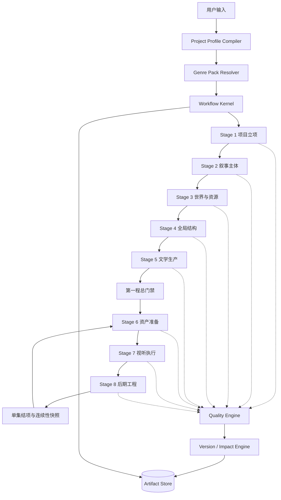

# 剧本创作工坊：三题材落地与全题材兼容升级方案

## 1. 文档目的

本文档用于指导 `python-backend` 的“两程九阶”升级改造。

本次升级的目标是：

1. 首批正式支持三类差异明显的题材：
   - 都市悬疑 / 现实推理；
   - 恋爱轻喜剧；
   - 科幻悬疑。
2. 保留现有“两程九阶”对外业务流程、旧 API、已有数据库和前端事件兼容性。
3. 将题材差异从阶段节点代码中抽离为可插拔的 Genre Pack（题材策略包）。
4. 为后续扩展历史、奇幻、动画、儿童、纪录片、群像、单元剧、音频剧等题材预留统一接口。
5. 增加产物版本、依赖关系、影响分析和局部重跑能力，使系统从一次性生成流程升级为可维护的内容生产平台。

本方案以当前实现为基础，主要涉及：

- `app/workflows/industrial_master_graph.py`
- `app/workflows/two_journey_runner.py`
- `app/workflows/nodes/stage1_ideation.py`
- `app/workflows/nodes/stage2_character.py`
- `app/workflows/nodes/stage3_environment_prop.py`
- `app/workflows/nodes/stage4_outline.py`
- `app/workflows/nodes/stage5_screenplay.py`
- `app/workflows/nodes/stage5_gatekeeper.py`
- `app/workflows/nodes/stage6_asset_truth.py`
- `app/workflows/nodes/stage7_storyboard_srt.py`
- `app/workflows/nodes/stage8_audio_mastering.py`
- `app/workflows/routers/audit_router.py`
- `app/workflows/adapters/drama_storage_adapter.py`
- `app/schemas/script_graph_state.py`
- `app/api/v1/workflow_control.py`

---

## 2. 现有流程基线

当前系统由两部分组成：

### 2.1 第一程：文学故事工程

```text
阶段 1 题材立项与创意动力
  → 阶段 2 角色引擎
  → 阶段 3 场景与道具工程
  → 阶段 4 全季大纲与音频母库
  → 阶段 5 Mini-Arc 波次剧本生成
  → 第一程文学总门禁
```

当前主要产物包括：

- 片名候选、Logline、核心讽刺、终局核爆点；
- 角色视觉锚点、心理四元组、语言指纹、关系矩阵；
- 场景做旧、道具状态和拟音信息；
- 全季大纲、集级任务卡、音乐动机；
- 按约 3 集一批生成的文学剧本；
- 集尾物理连续性快照。

### 2.2 第二程：视听工程

```text
阶段 6 单集资产准备
  → 阶段 7 单集分镜与 SRT
  → 阶段 8 音频工程与混音调度
  → 单集结项
  → 下一集阶段 6
```

第二程使用 `EpisodeScopedSubState`，按集加载必要的剧本、实体锚点、资产引用和连续性信息，避免把完整分镜和音频对象放入全局状态。

### 2.3 当前执行和持久化能力

现有系统已经具备：

- 文学主图、单集子图和全流程主图；
- LangGraph Checkpoint，MySQL 不可用时降级为 MemorySaver；
- 阶段重试和红蓝审核路由；
- Gatekeeper 人工审批和断点恢复；
- `DramaStorageAdapter` 阶段落库；
- EventBus / SSE 进度事件；
- Redis 读投影；
- 资产注册和 APPROVED 资产引用约束。

这些能力继续保留，升级主要发生在内部契约、题材策略、版本管理和质量引擎。

---

## 3. 当前架构的主要限制

### 3.1 题材字段没有真正驱动流程策略

当前 `genre` 更多是一个字符串，不能决定：

- 哪些字段必填；
- 使用哪种剧作结构；
- 使用哪种角色模型；
- 哪些连续性状态必须保存；
- 哪些资产需要生成；
- 哪种分镜模式优先；
- 哪种质量检查规则生效。

### 3.2 阶段规则偏向都市悬疑和现实反杀

当前许多规则默认存在：

- 物证；
- 反派压迫；
- 反杀；
- 角色 Want/Need/Lie/Ghost；
- 四阶段救赎弧；
- 3 个音乐动机；
- 40～60 秒微反转；
- 集尾断点；
- 现实磨损和负伤状态。

这些规则对都市悬疑有效，但不能成为所有题材的强制字段。

### 3.3 状态存在重复和兼容字段

当前同时存在 `characters_engine`、`characters`、`relationship_matrix`、`character_relationships`、`dual_track_relationships` 等字段。它们方便兼容旧实现，但容易出现多个字段内容不一致的问题。

### 3.4 阶段 5 使用集数统计推断下一集

当前波次逻辑主要依赖 `len(completed_screenplays)`。当存在删除、重跑、分支版本或人工插入时，可能出现集号错误。

### 3.5 红牌审核存在强制推进风险

当前重试达到上限后可能继续向下推进。安全、格式、资产状态和连续性硬错误不应通过熔断自动放行。

### 3.6 版本和影响分析不足

上游角色、世界规则或剧本修改后，系统还不能可靠计算哪些下游产物需要失效和重建。

---

## 4. 总体目标架构



系统分为四层：

### 4.1 Workflow Kernel：通用工作流内核

负责所有题材都需要的执行能力：

- 节点执行；
- 状态流转；
- 检查点；
- 暂停和恢复；
- 人工审批；
- 重试策略；
- 事件推送；
- 版本管理；
- 依赖分析；
- 任务队列；
- 并行调度。

建议新增目录：

```text
app/workflows/kernel/
├── executor.py
├── state_machine.py
├── stage_registry.py
├── run_context.py
├── checkpoint_service.py
├── approval_service.py
├── retry_policy.py
├── dependency_graph.py
└── impact_engine.py
```

现有 `industrial_master_graph.py`、`two_journey_runner.py`、`run_service.py` 和 `executor.py` 先作为兼容实现，逐步将通用逻辑迁移到 Kernel。

### 4.2 Genre Pack：题材策略包

题材包负责描述题材差异：

```python
class GenrePack:
    key: str
    version: str
    required_inputs: list[str]
    optional_inputs: list[str]
    dramaturgy_profile: dict
    world_rules_schema: dict
    entity_schema: dict
    continuity_schema: dict
    asset_policy: dict
    storyboard_policy: dict
    audio_policy: dict
    validators: list
    prompt_templates: dict
```

建议目录：

```text
app/workflows/genre_packs/
├── base.py
├── registry.py
├── schemas.py
├── policies.py
├── urban_mystery.py
├── romantic_comedy.py
└── science_fiction.py
```

当前 `app/workflows/nodes/stage6/genre_packs/urban_romance.py` 的逻辑应逐步迁移到统一注册机制，避免题材规则只存在于阶段 6。

### 4.3 Project Profile：项目级创作规则

```python
class ProjectProfile(BaseModel):
    project_id: int
    genre_pack_key: str
    genre_pack_version: str
    narrative_mode: str
    audience: str
    platform: str
    target_duration_sec: float
    total_episodes: int
    aspect_ratio: str
    visual_style: str
    target_video_engine: str
    dramaturgy_profile: dict[str, Any]
    world_rules: dict[str, Any]
    continuity_policy: dict[str, Any]
    asset_policy: dict[str, Any]
    audio_policy: dict[str, Any]
    quality_policy: dict[str, Any]
```

Project Profile 是工作流运行时的规则入口，节点不再通过全局默认值猜测题材。

### 4.4 Artifact and Version Layer：统一产物层

所有阶段产物统一视为版本化 Artifact：

```text
Project Bible
Entity Dossier
World Dossier
Narrative Plan
Screenplay
Asset Manifest
Storyboard
Subtitle
Audio Plan
Quality Report
Continuity Snapshot
```

建议新增：

```text
app/artifacts/
├── models.py
├── repository.py
├── version_service.py
├── dependency_service.py
├── snapshot_service.py
└── serializers.py
```

---

## 5. 三种首批题材策略

## 5.1 都市悬疑 / 现实推理

策略键：

```text
urban_mystery
```

### 核心模型

```text
冲突：信息差 + 利益对立
结构：线索链 + 误导链 + 揭示链
关键资产：角色、场景、物证
连续性：人物状态、道具状态、时间线
审核重点：线索闭环、动机合理、反转公平
```

### 专属字段

```json
{
  "clues": [],
  "red_herrings": [],
  "reveal_plan": [],
  "evidence_chain": [],
  "culprit_motive": {},
  "fair_play_constraints": []
}
```

该题材最大程度复用现有 Stage 1～8 规则，作为升级后的基准回归题材。

## 5.2 恋爱轻喜剧

策略键：

```text
romantic_comedy
```

### 核心模型

```text
冲突：关系目标不一致 + 误会 + 现实阻碍
结构：相遇 → 误解 → 靠近 → 失衡 → 选择
关键资产：角色互动、表情、场景氛围、生活道具
连续性：关系状态、情绪状态、空间关系
审核重点：化学反应、笑点升级、误会合理、情绪回报
```

不强制使用：

- 反派压迫；
- 核心物证；
- 负伤资产；
- 绝对静音卡点；
- 四阶段救赎；
- 恐惧型声音设计。

### 专属字段

```json
{
  "relationship_state": {
    "character_a_to_b": "curious",
    "character_b_to_a": "defensive"
  },
  "misunderstanding_chain": [],
  "romantic_payoff": {},
  "comedy_escalation": [],
  "emotional_beat_map": []
}
```

## 5.3 科幻悬疑

策略键：

```text
science_fiction
```

### 核心模型

```text
冲突：世界规则 + 技术限制 + 信息不对称
结构：规则展示 → 异常事件 → 假设验证 → 规则反转 → 代价选择
关键资产：设备、界面、载具、服装、场景、非人角色
连续性：时间、空间、技术状态、资源消耗、世界规则
审核重点：规则一致性、技术限制、因果闭环
```

### 专属字段

```json
{
  "world_rules": [
    {
      "rule_id": "RULE_001",
      "statement": "量子通讯每次使用会产生可追踪延迟",
      "scope": "global",
      "exceptions": [],
      "introduced_episode": 1,
      "resolved_episode": 8
    }
  ],
  "technology_states": [],
  "timeline_events": [],
  "resource_constraints": [],
  "species_or_entity_rules": []
}
```

---

## 6. 统一数据契约

### 6.1 GlobalDramaMasterState

当前状态继续兼容旧字段，同时增加规范字段：

```python
class GlobalDramaMasterState(BaseModel):
    project_profile: ProjectProfile
    narrative_entities: list[NarrativeEntity]
    world_entities: list[WorldEntity]
    narrative_plan: NarrativePlan
    completed_artifacts: dict[str, ArtifactRef]
    episode_status: dict[int, EpisodeStatus]
    continuity_registry: dict[str, ContinuitySnapshot]
    quality_reports: list[QualityReport]
    current_cursor: WorkflowCursor
```

旧字段保留一段迁移期：

```text
characters
characters_engine
relationship_matrix
environments_and_props
season_outlines
audio_bible
completed_screenplays
```

业务节点只写规范字段，适配器负责生成旧投影。

### 6.2 EpisodeScopedSubState

```python
class EpisodeScopedSubState(BaseModel):
    project_id: int
    episode_number: int
    artifact_version: int
    screenplay_ref: ArtifactRef
    task_card: dict[str, Any]
    incoming_continuity: ContinuitySnapshot | None
    outgoing_continuity: ContinuitySnapshot | None
    local_entities: list[EntityRef]
    asset_manifest: AssetManifest
    storyboard: StoryboardArtifact
    subtitle_artifact: SubtitleArtifact
    audio_plan: AudioPlan
    quality_reports: list[QualityReport]
```

### 6.3 统一叙事实体

```python
class NarrativeEntity(BaseModel):
    entity_id: str
    entity_type: Literal[
        "character",
        "group",
        "organization",
        "creature",
        "device",
        "vehicle",
        "location",
        "prop",
        "concept",
    ]
    name: str
    attributes: dict[str, Any]
    visual_anchor: dict[str, Any]
    audio_anchor: dict[str, Any]
    state_schema: dict[str, Any]
    relationships: list[dict[str, Any]]
```

这样机器人、组织、设备、非人实体不需要被强行放入 `characters` 或 `props`。

### 6.4 统一连续性快照

```python
class ContinuitySnapshot(BaseModel):
    snapshot_id: str
    episode_number: int
    scene_id: str | None
    temporal_state: dict[str, Any]
    spatial_state: dict[str, Any]
    entity_states: dict[str, Any]
    prop_states: dict[str, Any]
    costume_states: dict[str, Any]
    world_rule_states: dict[str, Any]
    narrative_state: dict[str, Any]
    audiovisual_state: dict[str, Any]
```

现有 `inter_episode_physical_snapshot`、`incoming_physical_continuity` 和 `outgoing_physical_continuity` 映射到该结构。

### 6.5 显式集状态

```python
class EpisodeStatus(BaseModel):
    episode_number: int
    status: Literal[
        "missing",
        "draft",
        "generated",
        "under_review",
        "approved",
        "rejected",
        "superseded",
    ]
    active_version: int | None
    last_error: str | None
    invalidated_by: list[str]
```

阶段 5 不再通过 `len(completed_screenplays)` 推断下一集。

---

## 7. 各阶段详细升级方案

## 7.1 阶段 0：项目配置和题材识别

### 当前实现

主要通过工作流创建参数和 `two_journey_runner.py` 初始化全局状态。

### 新增组件

```text
ProjectProfileCompiler
GenrePackResolver
```

### 新流程

```text
用户输入
 → 提取题材、平台、受众、时长、集数、媒介
 → 匹配 Genre Pack
 → 编译 Project Profile
 → 检查题材、媒介和模型兼容性
 → 初始化工作流
```

### 新 API

```http
GET  /api/v1/script-studio/genre-packs
GET  /api/v1/script-studio/genre-packs/{genre_pack_key}
POST /api/v1/script-studio/projects/preview-profile
POST /api/v1/script-studio/projects
GET  /api/v1/script-studio/projects/{project_id}/profile
PATCH /api/v1/script-studio/projects/{project_id}/profile
```

### 验收

- “未来空间站中的谋杀案”匹配 `science_fiction`；
- “办公室情侣误会喜剧”匹配 `romantic_comedy`；
- 无法识别时进入可配置的 `generic_drama`，不强行套都市悬疑。

## 7.2 阶段 1：项目立项与 Bible

### 当前实现

```text
app/workflows/nodes/stage1_ideation.py
```

### 改造为三个子步骤

```text
stage1_parse_intent
stage1_compile_profile
stage1_generate_project_bible
```

### 统一输出

```json
{
  "project_brief": {},
  "genre_profile": {},
  "theme": {},
  "tone": {},
  "audience": {},
  "world_premise": {},
  "dramaturgy_profile": {},
  "content_constraints": {},
  "visual_profile": {},
  "audio_profile": {},
  "quality_profile": {}
}
```

### 质量检查

- 题材识别是否正确；
- 题材规则是否完整；
- 世界设定是否自洽；
- 结构类型是否匹配题材；
- 时长和集数是否合理；
- 目标媒介是否支持；
- 用户硬性要求是否全部保留。

原有“禁令、核心讽刺、终局核爆点”保留为都市悬疑策略字段，不作为所有题材的必填项。

## 7.3 阶段 2：角色和叙事主体

### 当前实现

```text
app/workflows/nodes/stage2_character.py
```

### 改造目标

将内部模型从只支持 `characters` 扩展为 `narrative_entities`。

### 子步骤

```text
stage2_entity_discovery
stage2_entity_dossier
stage2_relationship_modeling
```

### 实体类型

- 真人角色；
- 组织和群体；
- AI；
- 设备；
- 车辆；
- 生物；
- 地点；
- 道具；
- 旁白主体；
- 纪录片采访对象。

### 题材适配

真人角色可以使用骨相、服装、声音和心理字段；科幻设备使用能力、限制、故障状态和声音签名；恋爱轻喜剧使用关系目标、误会触发器、喜剧反应和情绪推进。

### 兼容处理

生成新实体后，通过适配器继续投影：

```text
characters
character_relationships
relationship_matrix
dual_track_relationships
```

## 7.4 阶段 3：世界、场景、道具和资源

### 当前实现

```text
app/workflows/nodes/stage3_environment_prop.py
```

### 新名称

```text
stage3_world_builder
```

### 子步骤

```text
stage3_world_rules
stage3_locations
stage3_story_objects
stage3_resource_constraints
```

### 统一场景模型

```json
{
  "scene_id": "SCENE_001",
  "scene_type": "location",
  "spatial_topology": {},
  "visual_identity": {},
  "lighting_profile": {},
  "sound_profile": {},
  "continuity_state": {}
}
```

### 统一道具和设备模型

```json
{
  "entity_id": "PROP_001",
  "entity_type": "device",
  "narrative_function": "evidence",
  "state_machine": {
    "states": ["intact", "damaged", "offline", "repaired"]
  },
  "visual_anchor": {},
  "audio_anchor": {},
  "rules": []
}
```

### 题材差异

- 都市悬疑：物证、空间路线、破损状态、证据链；
- 恋爱轻喜剧：生活道具、约会空间、误会触发物；
- 科幻悬疑：设备、能源、界面、载具、时间和空间规则。

## 7.5 阶段 4：全局叙事规划

### 当前实现

```text
app/workflows/nodes/stage4_outline.py
```

### 新名称

```text
stage4_structure_planner
```

### 统一输出

```json
{
  "structure_type": "clue_reveal",
  "season_arc": {},
  "episode_cards": [],
  "beat_map": [],
  "continuity_plan": {},
  "asset_forecast": {},
  "audio_motif_plan": {}
}
```

### 支持的结构类型

```text
clue_reveal
relationship_progression
comedy_escalation
world_rule_discovery
mission_chain
anthology
documentary_outline
nonlinear_timeline
```

### 统一集级任务卡

```json
{
  "episode_number": 1,
  "episode_goal": {},
  "main_conflict": {},
  "emotional_beats": [],
  "information_change": {},
  "required_entities": [],
  "required_assets": [],
  "continuity_in": {},
  "continuity_out": {},
  "ending_function": "hook"
}
```

“前 3 秒 Hook、45 秒微反转、集尾断点”改为题材策略中的可配置规则。

## 7.6 阶段 5：文学剧本批次生成

### 当前实现

```text
app/workflows/nodes/stage5_screenplay.py
app/workflows/routers/audit_router.py
```

### 新流程

```text
加载 Project Profile
 → 加载批次任务卡
 → 加载上一集连续性快照
 → 生成剧本草稿
 → Schema 校验
 → 确定性规则校验
 → 题材规则校验
 → LLM 审美审查
 → 生成连续性快照
 → 写入新版本
 → 审批或继续
```

### 批次策略

```python
class BatchPolicy(BaseModel):
    unit_type: Literal[
        "episode",
        "mini_arc",
        "chapter",
        "scene_group",
        "interview_block",
    ]
    unit_size: int = 3
    preserve_cross_unit_continuity: bool = True
    allow_parallel_generation: bool = False
```

### 剧本版本结构

```json
{
  "artifact_type": "screenplay",
  "episode_number": 1,
  "version": 2,
  "scenes": [],
  "dialogue": [],
  "actions": [],
  "beats": [],
  "entity_state_changes": [],
  "world_rule_usage": [],
  "continuity_in": {},
  "continuity_out": {},
  "quality_report_id": "QR_001"
}
```

### 红牌处理规则

```text
格式错误：自动修复
题材规则错误：允许有限次重试，之后人工审核
安全或版权硬阻断：禁止自动放行
角色和世界连续性错误：回到对应上游节点
纯审美警告：允许带警告继续
```

## 7.7 第一程总门禁

### 当前实现

```text
app/workflows/nodes/stage5_gatekeeper.py
```

### 新状态

```python
class JourneyGateStatus(BaseModel):
    journey: Literal["literary", "visual"]
    status: Literal[
        "draft",
        "reviewing",
        "approved",
        "frozen",
        "dirty",
        "superseded",
    ]
    approved_version: int | None
    approved_by: str | None
    approved_at: str | None
    invalidated_artifacts: list[str]
```

### 新流程

```text
检查全季集状态
 → 检查结构、伏笔、连续性
 → 检查阶段 1～5 产物版本
 → 生成文学总审报告
 → 人工确认
 → 标记当前文学版本 approved
 → 建立 downstream_snapshot
 → 放行阶段 6
```

上游发生变更时使用 `dirty`，不再依赖一个不可逆的布尔锁。

## 7.8 阶段 6：单集资产准备

### 当前实现

```text
app/workflows/nodes/stage6_asset_truth.py
app/workflows/nodes/stage6/
app/workflows/utils/asset_protocol.py
app/workflows/utils/asset_slice_enricher.py
```

### 子步骤

```text
stage6_requirement_scan
stage6_asset_resolution
stage6_asset_generation
stage6_asset_validation
stage6_manifest_compile
```

### 统一资产状态

```text
MISSING
DRAFT
GENERATED
UNDER_REVIEW
APPROVED
REJECTED
DEPRECATED
```

### 资产版本

```json
{
  "asset_id": "CHAR_A_BASE",
  "asset_type": "character",
  "entity_id": "ENTITY_A",
  "version": 3,
  "status": "APPROVED",
  "source_artifact_version": 4,
  "style_profile_version": 2,
  "state_tags": ["base"],
  "derived_from": null,
  "uri": "..."
}
```

### 题材策略

- 都市悬疑：真实角色、场景、物证、负伤和破损状态；
- 恋爱轻喜剧：表情、服装变化、约会场景、生活道具；
- 科幻：设备、UI、特效、非人实体、空间载具和科技状态。

### 资产门禁

- 资产属于当前项目；
- 引用的版本为 APPROVED；
- 风格版本一致；
- 实体类型符合题材策略；
- 状态分支完整；
- 来源产物没有过期。

## 7.9 阶段 7：分镜和字幕

### 当前实现

```text
app/workflows/nodes/stage7_storyboard_srt.py
```

### 子步骤

```text
stage7_scene_segmentation
stage7_shot_planning
stage7_generation_mode_selection
stage7_timeline_compile
stage7_subtitle_compile
stage7_storyboard_lint
```

### 通用镜头模式

```text
first_last_frame
multi_image_reference
text_to_video
image_to_video
talking_head
motion_graphics
screen_capture
archive_footage
audio_only
```

首尾帧和多图参考只是视频生成模式，不应成为所有题材的唯一选择。

### 统一镜头模型

```json
{
  "shot_id": "EP01_SC02_SH03",
  "duration_sec": 4,
  "shot_type": "multi_image_reference",
  "entities": [],
  "location_ref": "SCENE_002",
  "asset_refs": [],
  "action": {},
  "dialogue": [],
  "camera": {},
  "lighting": {},
  "sound_cues": [],
  "subtitle_refs": [],
  "continuity_in": {},
  "continuity_out": {}
}
```

### SRT 确定性检查

- 时间码递增；
- 字幕不重叠；
- 字幕落在镜头包络内；
- 对白完整匹配；
- 字幕显示时长符合平台规则；
- 音频入点和字幕入点一致。

## 7.10 阶段 8：声音和后期工程

### 当前实现

```text
app/workflows/nodes/stage8_audio_mastering.py
```

### 子步骤

```text
stage8_audio_design
stage8_audio_asset_generation
stage8_mix_schedule
stage8_master_validation
```

### 统一音频计划

```json
{
  "tracks": [
    {
      "track_id": "VOICE_A",
      "type": "voice",
      "segments": []
    },
    {
      "track_id": "BGM_MAIN",
      "type": "music",
      "ducking_rules": []
    },
    {
      "track_id": "SFX",
      "type": "sfx",
      "segments": []
    }
  ],
  "loudness_target": -23,
  "silence_events": [],
  "fade_events": []
}
```

### 实际校验

当系统生成真实音频文件时，增加：

- LUFS 实测；
- True Peak 检测；
- 音轨长度检测；
- 对白遮蔽检测；
- 静音段检测；
- 音频、镜头和字幕时间轴比对。

---

## 8. 质量引擎升级

建议将现有 `red_blue_auditor.py` 和 `audit_router.py` 的职责拆分为四层。

```text
app/quality/
├── engine.py
├── schema_validator.py
├── deterministic_linter.py
├── genre_validator.py
├── continuity_validator.py
├── asset_validator.py
├── llm_critic.py
├── score_aggregator.py
└── policies.py
```

### 8.1 四层检查

1. **Schema Validator**：结构、类型、必填字段、枚举值。
2. **Deterministic Linter**：时间轴、集数、资产 ID、引用关系、状态。
3. **Genre Validator**：题材规则和项目 Profile 规则。
4. **LLM Critic**：审美、戏剧张力、对白自然度和视觉风险。

### 8.2 统一报告

```python
class QualityReport(BaseModel):
    report_id: str
    stage: str
    artifact_id: str
    status: Literal[
        "PASS",
        "PASS_WITH_WARNINGS",
        "NEEDS_REVIEW",
        "BLOCKED",
        "INVALID",
    ]
    deterministic_errors: list[Issue]
    genre_errors: list[Issue]
    continuity_errors: list[Issue]
    llm_warnings: list[Issue]
    retryable: bool
    requires_human: bool
    suggested_recovery: str | None
```

### 8.3 放行规则

```text
INVALID：必须修复，不能放行。
BLOCKED：必须人工或策略重写，不能自动熔断放行。
NEEDS_REVIEW：进入人工审核。
PASS_WITH_WARNINGS：允许继续，但记录风险。
PASS：正常推进。
```

安全、版权、格式、资产引用和连续性硬错误不能因为重试次数耗尽而自动放行。

---

## 9. 版本、依赖和影响分析

### 9.1 产物依赖

```text
Project Profile
    ↓
Stage 1 Bible
    ↓
Stage 2 Entities
    ↓
Stage 3 World
    ↓
Stage 4 Narrative Plan
    ↓
Stage 5 Screenplays
    ↓
Stage 6 Assets
    ↓
Stage 7 Storyboards
    ↓
Stage 8 Audio
```

### 9.2 修改影响示例

修改角色视觉锚点：影响该角色相关的 Stage 6 资产和 Stage 7 镜头。

修改科幻世界规则：影响 Stage 3、4、5、6、7、8。

修改第 3 集对白：影响第 3 集 Stage 7 和 Stage 8，不应重新生成全季。

### 9.3 影响分析接口

```http
POST /api/v1/script-studio/artifacts/{artifact_id}/impact-preview
POST /api/v1/script-studio/artifacts/{artifact_id}/create-revision
POST /api/v1/script-studio/rebuild-plan
POST /api/v1/script-studio/rebuild
```

### 9.4 影响分析响应

```json
{
  "changed_artifact": "CHAR_A_V3",
  "affected_artifacts": [
    "EP03_SCRIPT_V2",
    "EP03_ASSET_MANIFEST_V1",
    "EP03_STORYBOARD_V2"
  ],
  "preserved_artifacts": [
    "EP01_SCRIPT_V1",
    "EP02_SCRIPT_V1"
  ],
  "rebuild_order": [
    "stage5",
    "stage6",
    "stage7"
  ]
}
```

---

## 10. 数据库改造方案

### 10.1 继续兼容的现有表

```text
dramas
episodes
characters
scenes
props
assets
storyboards
workflow_runs
workflow_steps
```

### 10.2 建议新增表

```text
project_profiles
genre_pack_versions
artifact_versions
artifact_dependencies
quality_reports
continuity_snapshots
episode_statuses
rebuild_plans
```

### 10.3 artifact_versions

```text
id
project_id
artifact_type
entity_id
version
status
content_uri
content_hash
source_snapshot_id
created_by
created_at
superseded_at
```

### 10.4 JSON 的使用边界

继续使用 JSON 保存：

- 题材扩展字段；
- Prompt 模型原始响应；
- 可变视觉和声音参数；
- 非核心渲染参数。

使用关系表保存：

- 版本；
- 状态；
- 依赖；
- 审批；
- 质量报告；
- 任务运行；
- 重建计划。

---

## 11. 工作流执行方案

### 11.1 保留现有主图和子图

第一阶段不替换 `industrial_master_graph.py`，而是增加题材感知构建函数：

```python
build_genre_aware_literary_graph(profile, checkpointer)
build_genre_aware_episode_graph(profile, checkpointer)
```

内部仍可调用现有节点：

```text
stage1_ideation_node
stage2_character_node
stage3_environment_prop_node
stage4_outline_node
stage5_screenplay_node
stage6_asset_truth_node
stage7_storyboard_srt_node
stage8_audio_mastering_node
```

节点通过 `WorkflowRunContext` 读取 Profile 和策略包。

### 11.2 统一运行上下文

```python
class WorkflowRunContext:
    workflow_run_id: str
    project_id: int
    profile: ProjectProfile
    genre_pack: GenrePack
    artifact_versions: dict[str, int]
    checkpoint_id: str | None
    retry_policy: RetryPolicy
    approval_policy: ApprovalPolicy
```

### 11.3 第二程并行边界

第一版采用保守并行：

```text
阶段 6 需求扫描：可并行
阶段 6 已有资产查询：可并行
阶段 6 独立资产生成：可并行
阶段 7 场景切片：可并行
阶段 7 最终时间轴：串行
阶段 8 音频素材准备：可并行
阶段 8 最终混音：串行
```

集间连续性快照是串行边界。

---

## 12. API 和事件升级

### 12.1 题材包 API

```http
GET /api/v1/script-studio/genre-packs
GET /api/v1/script-studio/genre-packs/{genre_pack_key}
```

### 12.2 阶段统一 API

```http
POST /api/v1/script-studio/projects/{id}/stages/{stage}/run
POST /api/v1/script-studio/projects/{id}/stages/{stage}/approve
POST /api/v1/script-studio/projects/{id}/stages/{stage}/reject
POST /api/v1/script-studio/projects/{id}/stages/{stage}/retry
```

### 12.3 版本和重建 API

```http
GET  /api/v1/script-studio/projects/{id}/artifacts
GET  /api/v1/script-studio/artifacts/{artifact_id}/versions
POST /api/v1/script-studio/artifacts/{artifact_id}/revise
POST /api/v1/script-studio/artifacts/{artifact_id}/impact-preview
POST /api/v1/script-studio/rebuild-plan
POST /api/v1/script-studio/rebuild
```

### 12.4 事件兼容

现有事件继续发送：

```text
STAGE_PROGRESS
RED_BLUE_AUDIT
MINI_ARC_COMPLETED
FIRST_JOURNEY_LOCKED
EPISODE_VISUAL_STARTED
EPISODE_VISUAL_COMPLETED
PIPELINE_COMPLETED
PIPELINE_ERROR
```

新增事件：

```text
PROJECT_PROFILE_COMPILED
GENRE_PACK_SELECTED
ARTIFACT_VERSION_CREATED
ARTIFACT_INVALIDATED
REBUILD_PLAN_CREATED
QUALITY_BLOCKED
HUMAN_REVIEW_REQUIRED
CONTINUITY_CONFLICT
```

统一事件格式：

```json
{
  "event_id": "EVT_001",
  "event_type": "QUALITY_BLOCKED",
  "project_id": 1,
  "workflow_run_id": "RUN_001",
  "stage": 5,
  "artifact_id": "EP03_SCRIPT_V2",
  "payload": {},
  "created_at": "..."
}
```

---

## 13. 分阶段实施计划

## Phase 1：内核抽象和数据兼容

目标：

- 增加 `ProjectProfile`；
- 增加 `GenrePack` 接口和注册表；
- 增加 `ArtifactRef`；
- 增加 `EpisodeStatus`；
- 增加统一 `QualityReport`；
- 禁止 RED_BLOCKING 硬错误自动放行；
- 建立新旧字段适配器。

验收：现有都市悬疑流程、旧 API 和旧数据不退化。

## Phase 2：都市悬疑策略迁移

目标：

- 将当前默认都市悬疑规则整理成正式 Genre Pack；
- 将现有 Stage 6 题材代码纳入统一注册表；
- 所有阶段读取 Project Profile；
- 产物版本化。

验收：现有测试和示例流程完整通过。

## Phase 3：恋爱轻喜剧策略

重点：

- 关系状态；
- 误会链；
- 喜剧升级；
- 表情和互动资产；
- 对白优先混音；
- 不强制物证、反派和救赎弧。

## Phase 4：科幻悬疑策略

重点：

- 世界规则；
- 技术限制；
- 设备和非人实体；
- 时间线；
- 科技状态连续性；
- UI、特效和设备镜头；
- 科幻声场。

## Phase 5：版本、影响分析和局部重跑

重点：

- Artifact Version；
- Dependency Graph；
- Impact Preview；
- Rebuild Plan；
- 上游变更后的下游失效；
- 单集和单镜头局部重建。

## Phase 6：并行和生产化

重点：

- 阶段 6 资产并行；
- 阶段 7 场景并行；
- 阶段 8 音频素材并行；
- 任务可靠重试；
- 运行监控；
- 成本统计；
- 模型质量评估。

---

## 14. 测试方案

### 14.1 策略包测试

每个 Genre Pack 必须测试：

- Profile 编译；
- 必填字段；
- Prompt 渲染；
- 题材规则；
- 连续性规则；
- 资产策略；
- 分镜策略；
- 音频策略。

### 14.2 契约测试

覆盖：

- 旧 API；
- 新 API；
- 旧数据读取；
- 新数据写入；
- 旧事件；
- 新事件；
- SQLite；
- MySQL。

### 14.3 工作流测试

每种题材至少一条完整链路：

```text
Stage 1 → Stage 5 → Gatekeeper → Stage 6 → Stage 7 → Stage 8
```

### 14.4 必测回归场景

- Stage 5 波次重跑；
- 修改角色后局部重建；
- 修改世界规则后全链路失效；
- Stage 6 资产复用；
- Stage 7 引用过期资产；
- Stage 8 字幕和音频时长不一致；
- RED_BLOCKING 不得自动放行；
- Gatekeeper 暂停和恢复；
- Checkpointer 降级；
- 队列重复投递幂等性。

### 14.5 题材测试

都市悬疑：线索闭环、物证连续、反转公平。

恋爱轻喜剧：关系连续、误会有来源、笑点不依赖角色降智。

科幻悬疑：世界规则不被无故违反、技术状态连续、时间线合法。

---

## 15. 推荐目录结构

建议最终目录如下：

```text
app/
├── domain/
│   ├── artifacts/
│   ├── entities/
│   ├── continuity/
│   ├── projects/
│   └── quality/
├── workflows/
│   ├── kernel/
│   ├── stages/
│   │   ├── stage1/
│   │   ├── stage2/
│   │   ├── stage3/
│   │   ├── stage4/
│   │   ├── stage5/
│   │   ├── stage6/
│   │   ├── stage7/
│   │   └── stage8/
│   ├── genre_packs/
│   ├── routers/
│   ├── adapters/
│   └── two_journey_runner.py
├── quality/
├── artifacts/
├── repositories/
├── prompts/
│   ├── core/
│   └── genre/
└── schemas/
    ├── core/
    ├── artifacts/
    ├── continuity/
    └── genre/
```

不建议第一阶段一次性移动所有现有文件。推荐先使用包装器和适配器：

```text
新 Kernel
  → 调用旧节点
  → 旧节点输出
  → 新契约适配
  → 新质量引擎
  → 新版本存储
```

---

## 16. 工作量和完成标准

这是一次中大型升级，不是简单增加 Prompt。

建议按以下顺序执行：

1. 先完成通用内核和数据契约；
2. 再迁移都市悬疑，确保旧流程不退化；
3. 再实现恋爱轻喜剧，验证低压关系型题材；
4. 再实现科幻悬疑，验证世界规则和非现实资产；
5. 最后实现版本影响分析、局部重建和并行调度。

阶段一可控制在约 1～2 个月；完整的三题材工业化版本预计需要 3～6 个月，具体取决于实际音频、资产生成和前端改造范围。

---

## 17. 最终目标

改造完成后，用户仍然看到熟悉的“两程九阶”，但系统内部变为：

```text
项目配置编译
 → 题材策略加载
 → 通用阶段执行
 → 题材规则校验
 → 版本化产物
 → 可恢复工作流
 → 影响分析
 → 局部重建
```

最终形成：

```text
一套工作流内核
+ 多个题材策略包
+ 可组合质量规则
+ 可扩展实体和资产模型
+ 统一版本与依赖系统
```

这样既能最大程度复用当前实现，又不会把未来的题材扩展写成大量 `if genre == ...` 分支。
